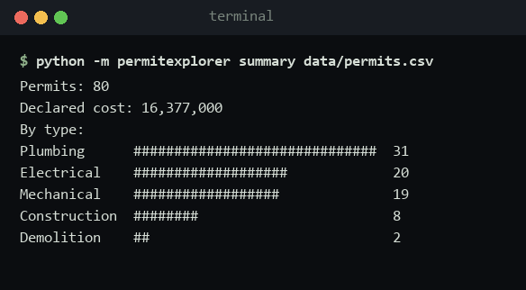

<p align="center"></p>

# dc-building-permits-explorer

[](https://github.com/yassine2med/dc-building-permits-explorer/actions/workflows/ci.yml)  

Counts building permits and sums declared cost from a permit CSV, with a text bar chart.



## What it is for

City building permit data is published as large CSV files that are hard to read without a spreadsheet. A permit technician, construction project engineer or building manager uses this tool to answer the common questions from the command line: how many permits by type, ward, status or month, and how much declared cost by type or ward. They get a quick bar chart in the terminal instead of building a pivot table by hand.

## Install

```
git clone <repo-url> dc-building-permits-explorer
cd dc-building-permits-explorer
pip install -e .
```

Python 3.10 or newer. No dependencies.

## How to use

| I want to | Command |
| --- | --- |
| See the total count, total declared cost and permits by type | `python -m permitexplorer summary data/permits.csv` |
| Count permits by kind, ward, status or month (default kind) | `python -m permitexplorer count data/permits.csv --by month` |
| Sum declared cost by kind or ward (default kind) | `python -m permitexplorer cost data/permits.csv --by ward` |
| Limit any command to one permit type | `python -m permitexplorer summary data/permits.csv --kind Plumbing` |
| Limit any command to one ward | `python -m permitexplorer cost data/permits.csv --by kind --ward "Ward 2"` |
| Limit any command to one issue year | `python -m permitexplorer count data/permits.csv --by month --year 2025` |
| See all options | `python -m permitexplorer --help` |

Worked example:

```
python -m permitexplorer summary data/permits.csv
```

Output:

```
Permits: 80
Declared cost: 16,377,000
By type:
Plumbing      ##############################  31
Electrical    ###################             20
Mechanical    ##################              19
Construction  ########                        8
Demolition    ##                              2
```

## How it works

- The CSV needs the columns permit_id, type, ward, status, issued (YYYY-MM-DD) and cost.
- Rows load into a dataclass; a bad date or number stops the load and names the line.
- `--kind`, `--ward` and `--year` filter before counting.
- `count --by` groups by kind, ward, status or month; `cost --by` sums cost by kind or ward.
- Bars are scaled so the largest value fills 30 characters.

## Limits

The sample data is synthetic. Real open data portals use different column names, so map your export to the six columns above first. There is no web interface; output is text only.

Run the tests with `python -m pytest -q`.

## License

MIT. Copyright 2026 Yassine Emhamed.
